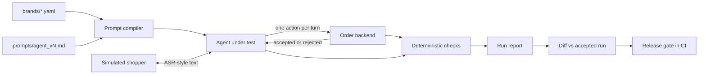

# VoiceOps Kit

Per-brand voice agents for cash-on-delivery (COD) confirmation and failed-delivery (NDR) calls, with the operations layer around them: brand configs, simulated shoppers, deterministic checks, a regression diff and a release gate.

Indian D2C brands lose money when COD orders are refused at the door and shipped back. A short call before dispatch, or right after a failed delivery, recovers many of those orders. Every brand wants that call handled differently: different fees, offers, cancellation rules and address policies. This repo treats each brand's requirements as a validated config file, compiles it into the agent's instructions, and tests every change against simulated customers before it goes live.

Both brands in this repo are fictional. The calls are text simulations of phone calls: shoppers are played by an LLM or a fixed script, and customer replies are converted to lowercase, unpunctuated text to look like a speech-to-text transcript. There is no telephony or audio.

## Results

<!-- results:start -->
Accepted run [`20261108-012620-agent_v1-full`](evals/runs/20261108-012620-agent_v1-full/report.md): agent prompt `agent_v1` on `openai/gpt-oss-20b`, against simulated shoppers on `openai/gpt-oss-120b`.

- **18 of 24 simulated calls passed every check** (kesar_and_clay 9/13; trailknot 9/11).
- 1 JSON repairs in 89 agent calls; 1 actions rejected by the backend.
- About 6,808 tokens per call placed; agent model latency 604 ms median.

| Check | Passed |
|---|---|
| outcome | 83% (20/24) |
| order_state | 90% (9/10) |
| completed | 100% (23/23) |
| no_rejected_actions | 96% (22/23) |
| privacy | 100% (23/23) |
| no_unlisted_discount | 96% (22/23) |
| brand_named | 100% (23/23) |
| stops_after_close | 100% (3/3) |
| turn_budget | 100% (1/1) |
<!-- results:end -->

## How It Works



- **Brand config.** `brands/<brand>.yaml` holds what the merchant decided: COD fee, prepaid offer, whether the address can change, reattempt window, delivery days, calling hours, hand-off topics, FAQ answers. Pydantic validates it, so a typo fails before any call.
- **Agent.** The prompt template in `prompts/` is compiled per brand and per call. It lists only the actions that brand allows. The agent replies in JSON: what to say, at most one action, and whether to end the call.
- **Order backend.** `voiceops/orders.py` decides whether each action is allowed. Policy lives in code, so a prompt mistake cannot change an order the merchant's rules forbid. A rejected action is sent back to the agent, which gets one retry before the customer hears anything, so it cannot tell a customer something was done when it was not.
- **Pre-call guards.** Calls outside the brand's calling window, or to a number on the do-not-call list, are never placed.
- **Scenarios.** `scenarios/*.yaml` define 20 situations played against the brands they apply to (24 calls): straight confirmations, cancellations, wrong addresses, fee questions, discount haggling, a prompt-injection attempt, a Hinglish speaker, a wrong number, a busy customer, an opt-out, silence, a health concern, and five kinds of failed delivery. Each one says which outcomes count as correct for each brand.
- **Checks.** Deterministic, so the same transcript always gets the same score. See the table below.
- **LLM judge.** For what rules cannot check: language match, brevity, grounding, answered questions, false claims. `label` records your own verdicts and `agreement` shows where the judge is too lenient.
- **Release gate.** `accept` records a full run as the baseline and refuses one that breaks calls the previous baseline passed, unless you say why. CI fails if the live prompt, a brand config or the test suite changed after the accepted run.

## Checks

| Check | Fails when |
|---|---|
| outcome | The order ended in a status the scenario does not allow for that brand |
| order_state | The address, reattempt date or dispute flag is not what the scenario expects |
| completed | The call hit the turn limit or the model returned invalid output twice |
| no_rejected_actions | The agent tried an action the backend refused |
| privacy | Order details were spoken before the customer confirmed who they are, or at all on a wrong-number call |
| no_unlisted_discount | The agent mentioned a discount other than the brand's configured one |
| brand_named | The first turn did not say which brand is calling |
| stops_after_close | The agent kept talking after an opt-out, wrong number or no-response |
| turn_budget | A no-response call took more agent turns than allowed |

## Quick Start

Needs Python 3.10 or newer and a free Groq API key. Commands are for Windows PowerShell; on macOS or Linux use `source .venv/bin/activate` and `cp`.

```powershell
python -m venv .venv
.\.venv\Scripts\Activate.ps1
pip install -r requirements.txt
copy .env.example .env        # then put your Groq key in .env
python -m pytest              # offline; uses a fake model
python -m voiceops validate
python -m voiceops chat kesar_and_clay cod     # you play the customer
python -m voiceops run --suite smoke           # 8 simulated calls
python -m voiceops run --suite full            # 24 simulated calls
```

Every model reply is cached in `evals/cache.sqlite`, so rerunning a command replays earlier answers instantly. If a run stops on the provider's daily limit, run the same command again later and it continues from the cache.

## Changing a Prompt

```powershell
copy prompts\agent_v1.md prompts\agent_v2.md   # edit v2
python -m voiceops run --suite smoke --prompt agent_v2
python -m voiceops diff <accepted-run> latest   # fixed, broken, still failing, call by call
python -m voiceops run --suite full --prompt agent_v2
python -m voiceops accept latest                # promotes agent_v2 if nothing regressed
python -m voiceops gate
```

Record what you found and changed in [docs/FAILURES.md](docs/FAILURES.md).

## Onboarding a Brand

```powershell
python -m voiceops new-brand my_brand    # copies brands/_template.yaml
python -m voiceops validate
python -m voiceops show-prompt my_brand cod
```

Then add test orders in `scenarios/orders.yaml`, add the brand to the scenarios that apply, and run the full suite. [docs/ONBOARDING.md](docs/ONBOARDING.md) has the merchant intake questions and the sign-off checklist; [docs/RUNBOOK.md](docs/RUNBOOK.md) covers what to do when something fails.

## Budget

On Groq's free tier, limits apply per model, which is why the agent and the shopper use different models. A compiled agent prompt is about 1,000 tokens and every agent turn resends it, so a full run is the expensive one: run the smoke suite while iterating. Each run's report lists the tokens it used, and `trace.jsonl` in the run folder has every call.

## Limits

- Shoppers are simulated. A scenario passing means the agent handled that script, not that real customers will behave the same way.
- Text only. Speech recognition errors, accents, interruptions and latency on a real phone line are not simulated beyond lowercasing and stripping punctuation.
- 24 calls is a small suite. It catches regressions in the situations it covers and says nothing about the rest.
- The judge is itself a model. Its verdicts are informative only where `agreement` shows it matches hand labels.
- The backend is in memory. In production it would call the order system and the WhatsApp and courier APIs.

## Layout

```
brands/        one YAML per brand, plus _template.yaml
prompts/       versioned agent, shopper and judge prompts
scenarios/     simulated situations and test orders
voiceops/      the engine: config, backend, LLM client, simulation, checks, report, gate
evals/runs/    one folder per run: transcripts, report.md, results.json, trace.jsonl
docs/          design notes, onboarding template, runbook, failure log
tests/         offline tests with a scripted fake model
```
